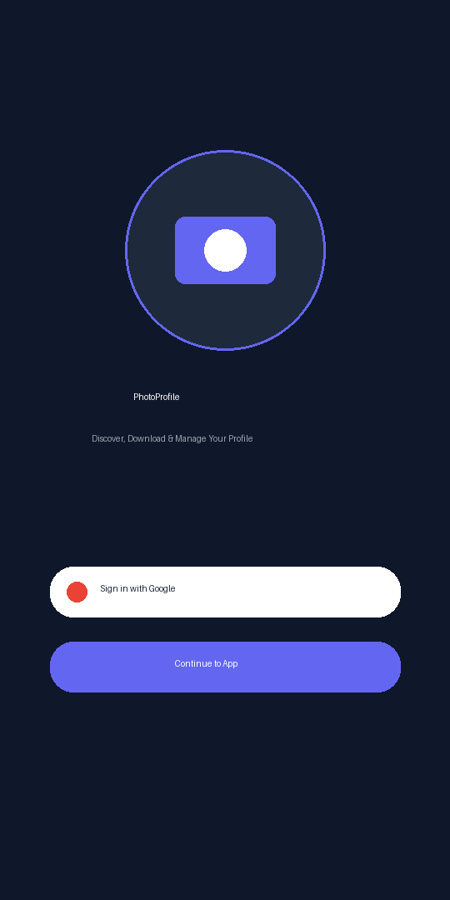
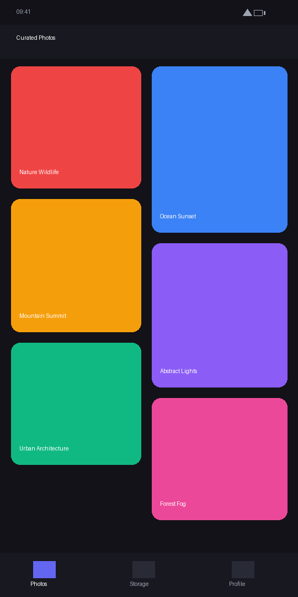
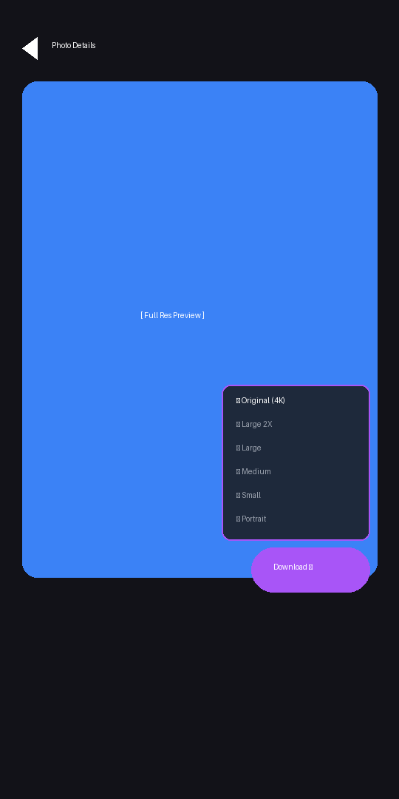
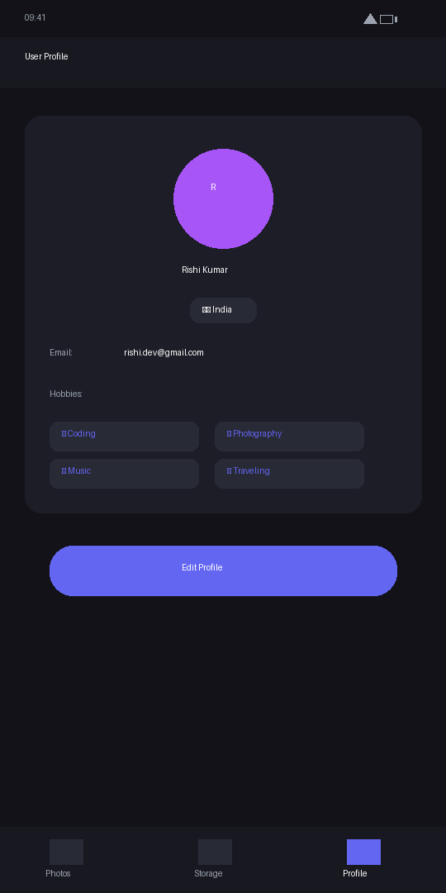
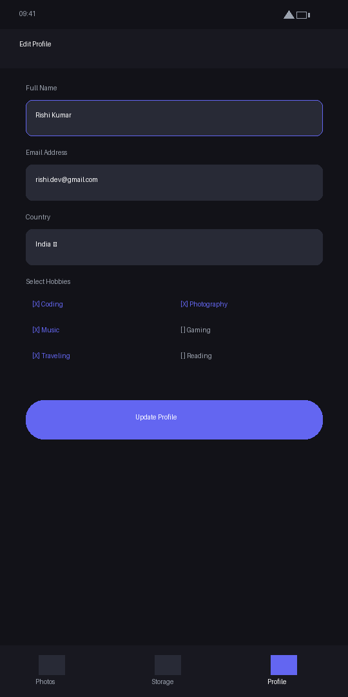
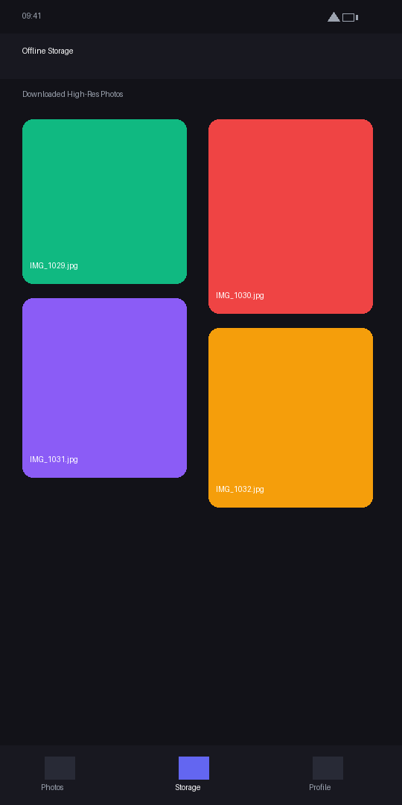

# 📸 PhotoProfile - Modern Android Photography & Profile App

[](https://developer.android.com/)
[](https://kotlinlang.org/)
[](https://gradle.org/)
[](https://developer.android.com/about/versions/pie)
[](https://developer.android.com/about/versions/16)
[](https://developer.android.com/topic/architecture)

A feature-rich, modern Android application built using **Kotlin**, **Clean Architecture**, **MVVM**, and **Material Design 3**. **PhotoProfile** offers a curated high-resolution photography feed powered by the Pexels REST API, multi-resolution photo downloading, local photo storage, seamless Google Authentication with Credential Manager API, and profile management stored in a local database.

---

## 📑 Table of Contents

- [✨ Features](#-features)
- [📱 Screenshot Gallery](#-screenshot-gallery)
- [🏗 Architecture & Project Structure](#-architecture--project-structure)
- [🛠 Tech Stack & Libraries](#-tech-stack--libraries)
- [⚙️ Setup & Installation](#️-setup--installation)
- [🧪 Running Unit Tests](#-running-unit-tests)
- [🤝 Contributing](#-contributing)
- [📄 License](#-license)

---

## ✨ Features

- **🔐 Google Sign-In & Credential Manager Integration**
  - Modern OTP-less Google Authentication using Android **Credential Manager API** and **Firebase Auth**.
  - Persistent login state stored locally via `SharedPreferences`.

- **🖼 Curated Photography Feed (Pexels API)**
  - Dynamic 2-column staggered grid layout displaying high-definition photos.
  - Infinite scroll pagination using Coroutines and `StaggeredGridLayoutManager`.
  - Image caching and smooth loading powered by **Glide**.

- **📥 Multi-Resolution Photo Downloader**
  - Download photos in 8 different resolutions (*Original 4K, Large 2X, Large, Medium, Small, Portrait, Landscape, Tiny*).
  - Floating action menu with resolution popup selector.
  - Full-screen high-resolution photo inspector.

- **💾 Offline Storage & Local Downloads**
  - Dedicated storage manager displaying locally saved photo downloads.

- **👤 User Profile Management**
  - Create, view, and update user profiles persisted in a local database (`ProfileDataBase`).
  - Customizable profile attributes: Name, Email, Country (dropdown selector), and multi-select Hobbies.
  - Real-time form validation with error reporting.

---

## 📱 Screenshot Gallery

| Intro & Sign In | Curated Feed | Photo Detail & Download |
| :---: | :---: | :---: |
|  |  |  |

| User Profile | Edit Profile | Offline Storage |
| :---: | :---: | :---: |
|  |  |  |

---

## 🏗 Architecture & Project Structure

The project strictly follows **Clean Architecture** combined with the **MVVM (Model-View-ViewModel)** design pattern and **Koin** Dependency Injection.

```
com.example.photoprofile
│
├── data                       # Data Layer (Repositories & Data Sources)
│   ├── local                  # SQLite Database, DTOs & File Download manager
│   ├── remote                 # Pexels Retrofit API service & DTOs
│   └── repository             # Repository implementations & Data Mappers
│
├── di                         # Dependency Injection Layer
│   └── DIContainer.kt         # Koin DI Modules (ViewModels, UseCases, Repositories)
│
├── domain                     # Domain Layer (Business Logic & Entities)
│   ├── model                  # Domain Data Models
│   ├── repository             # Repository Interfaces
│   └── usecase                # Self-contained Business Use Cases
│
└── ui                         # Presentation Layer (UI & ViewModels)
    ├── adapter                # RecyclerView Adapters (ImageAdapter, LoadingAdapter)
    ├── dataclass              # Presentation UI State models & Mappers
    ├── uistate                # Unidirectional StateFlow UI States
    └── viewmodel              # ViewModels (PhotosViewModel, UserViewModel, etc.)
```

---

## 🛠 Tech Stack & Libraries

| Category | Technology / Library | Description |
| :--- | :--- | :--- |
| **Language** | [Kotlin 2.0.21](https://kotlinlang.org/) | 100% Idiomatic Kotlin with Coroutines & Flow |
| **UI Framework** | [Material Design 3](https://m3.material.io/) | XML Layouts, Navigation Component, Extended FAB |
| **Architecture** | Clean Architecture + MVVM | Unidirectional Data Flow with `StateFlow` |
| **Dependency Injection** | [Koin 3.5.6](https://insert-koin.io/) | Lightweight & pragmatic Kotlin DI framework |
| **Networking** | [Retrofit 2.11.0](https://square.github.io/retrofit/) | Type-safe HTTP client with Gson Converter |
| **Image Loading** | [Glide 4.16.0](https://github.com/bumptech/glide) | Fast & efficient media management and caching |
| **Authentication** | Credential Manager + Firebase Auth | Modern Google Identity Token authentication |
| **Local Persistence** | Custom SQLite Database | Local database for storing user profile records |
| **Build System** | Gradle 9.4.1 + AGP 8.13.2 | Version Catalogs (`libs.versions.toml`) |
| **Testing** | JUnit 4, MockK, Coroutines Test | Unit tests for ViewModels, UseCases & Business Logic |

---

## ⚙️ Setup & Installation

### Prerequisites
- **Android Studio** (Ladybug or later recommended)
- **JDK 17** or **JDK 25**
- **Android SDK 36**

### Steps
1. **Clone the Repository:**
   ```bash
   git clone https://github.com/YOUR_USERNAME/PhotoProfile.git
   cd PhotoProfile
   ```

2. **Configure App Properties:**
   Ensure `app/appconfig.properties` contains your secret key and signing credentials:
   ```properties
   MY_SECRET_API_KEY=YOUR_PEXELS_API_KEY
   DEBUG_FILE_PATH=E:\\keystore-photoProfile\\debug.keystore
   DEBUG_PASSWORD=android
   DEBUG_ALIAS=debug
   ```

3. **Open & Sync in Android Studio:**
   - Open the cloned directory in Android Studio.
   - Run Gradle Sync to fetch dependencies defined in `gradle/libs.versions.toml`.

4. **Build & Run:**
   - Connect an Android device or emulator (Android 9.0+ / API 28+).
   - Press `Run` or execute via CLI:
     ```bash
     ./gradlew assembleDebug
     ```

---

## 🧪 Running Unit Tests

To run the automated unit tests:

```bash
./gradlew app:testDebugUnitTest
```

All 7 ViewModel validation unit tests are verified and green.

---

## 🤝 Contributing

Contributions, issues, and feature requests are welcome! Feel free to open an issue or submit a Pull Request.

---

## 📄 License

```
Copyright 2026 Rishi Kumar

Licensed under the Apache License, Version 2.0 (the "License");
you may not use this file except in compliance with the License.
You may obtain a copy of the License at

    http://www.apache.org/licenses/LICENSE-2.0

Unless required by applicable law or agreed to in writing, software
distributed under the License is distributed on an "AS IS" BASIS,
WITHOUT WARRANTIES OR CONDITIONS OF ANY KIND, either express or implied.
See the License for the
